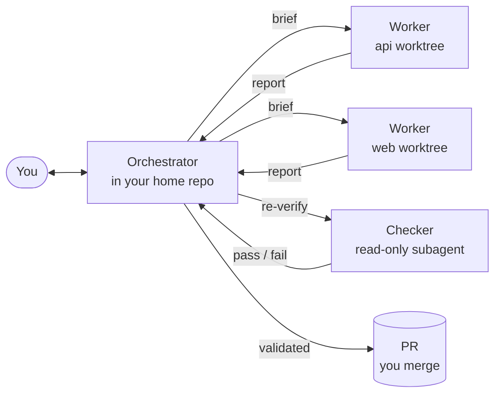

# Bondsmith


**Projects, for Claude Code in your terminal.**

Projects in the Claude apps give a body of work one home: shared files, instructions and many conversations. Bondsmith gives Claude Code the same thing, across every repo you work in. You talk to one orchestrator session in a home repo. It writes a brief for each task, starts a worker session in a git worktree of the right repo, has a checker re-verify the result, and tells you when there is a PR to merge.



- **One place to talk to.** The orchestrator routes each task to the right repo, so you stop juggling a terminal per repo.
- **Nothing is done until it is checked.** A checker subagent re-checks every "Done when" item and review step itself; a worker saying "done" is not evidence. Only the orchestrator marks a task `validated`, and you merge.
- **It survives a restart.** All state lives in Markdown files in the home repo: the board, and each task's brief, report and check. A new orchestrator can take over any day from the files alone.

Status: v0.1, an ongoing effort in early use, and it will change as I learn from running it. It relies on Claude Code's background sessions, which are a research preview. Issues, ideas and stories of how you run it are welcome in [GitHub issues](https://github.com/cdotta/bondsmith/issues).

## Install

```
/plugin install bondsmith --marketplace cdotta/bondsmith
```

That one-step form needs Claude Code 2.1.275 or later. On older versions, run `/plugin marketplace add cdotta/bondsmith`, then `/plugin install bondsmith@bondsmith`. Auto-update is off for third-party marketplaces: update with `claude plugin update bondsmith@bondsmith`, then run `/bondsmith:setup` again in your home repo so it rewrites its scripts.

To try a clone without installing, start Claude Code with `claude --plugin-dir <path to the clone>`.

## Requirements

- Claude Code with background sessions and cross-session messaging, v2.1.224 or later. Built and tested on v2.1.328, macOS.
- `git`, `jq` and `gh` (signed in) on your `PATH`. Without `jq` the start script cannot check trust and the orchestrator does not notice blocked workers until your next message. Without `gh` it cannot see that a PR merged.
- Access to the models in the config. The defaults are `fable` for the orchestrator and `opus` for workers and the checker.
- A home repo: a git repo with at least one commit, not inside the plugin's directory, since Claude Code write-protects every file under a loaded plugin. It can be a repo you already work in, or a new one that only holds the orchestrator's files.
- Every repo workers run in, and the home repo, trusted by Claude Code. See [Trust](#trust).

## First run

1. In the home repo, run `/bondsmith:setup`. It creates `orchestrator/config.md`, `orchestrator/board.md` and `orchestrator/tasks/`, appends a short pointer block to `CLAUDE.md`, adds the worktree folder to `.gitignore`, and writes two scripts, `orchestrator/start` and `orchestrator/watch`. Running it again only adds what is missing and rewrites the two scripts. If your `CLAUDE.md` lists repos with their paths, setup fills the Repos table from it.
2. Start the orchestrator from a terminal, optionally with a first task:

   ```sh
   sh orchestrator/start "add a CONTRIBUTING.md"
   ```

   The config's only Repos row is the home repo itself, so this works before you edit anything.
3. To work in other repos, edit `orchestrator/config.md` and restart the orchestrator. Config edits apply at the next start.
   - **Repos:** one row per repo: its path from the home repo, what it owns (used to route a task), the base branch, and the review steps that must run before a PR. A review step the checker cannot run itself, such as one that starts its own subagents, gets ` (worker)` after its name, and the worker's run on the final commit counts. Mark it ` (independent)` instead to have each check round run it again in a full-tool agent beside the checker: the step fails on an unfixed finding of its top two severities (BLOCKER and MUST-FIX, for example) that the PR body does not declare.
   - **Workers:** models, permission mode, and `allowed tools`. Add the test, build and lint commands your workers run, for example `Bash(npm test *)`, or each one stops the worker on a permission prompt.
   - **Catalogue:** files in the home repo that a worker should read for some kinds of task, and whether the checker must check the output against them.

The start script launches the orchestrator under the configured name and model, compacting at 200k tokens, with each repo as a working directory and with allow rules for its own commands, so it does not ask about each worker it starts. If it prints a warning, it waits for Enter, because `claude` takes over the screen and would hide it. It runs `claude` directly, so a shell function or alias named `claude` does not apply; put the settings such a wrapper adds in the config's `extra settings`, which the orchestrator and workers both get.

## Trust

`claude --bg` refuses to start in a repo Claude Code has not trusted, so each target repo and the home repo must be trusted once. Run `claude` in the repo and accept the trust prompt.

If no prompt appears, a parent folder is already trusted. That hides the prompt but records nothing for the repo itself, and background sessions still refuse it. The start script warns about every untrusted repo (when `jq` is installed) and names the trusted parent when there is one. Until a repo is trusted, Claude Code itself also asks you to trust it at every orchestrator start, because the start script adds each repo as a working directory, and that answer lasts only for the session. Bondsmith cannot fix this for you; it is Claude Code's own state, in `~/.claude.json`.

## Day to day

- **Give it work:** tell the orchestrator a task, or pass one to `sh orchestrator/start "<task>"`. It picks the repo, writes a brief, cuts a worktree and branch named after the task id, and starts a worker.
- **A task's path:** `briefed` → `running` → the worker reports ready → the checker re-runs every "Done when" item and review step → `validated`, or back to the worker with what failed. After the configured number of failed rounds (default 2), it comes to you. When you merge the PR, the orchestrator closes the task.
- **When it needs you:** a worker with a question goes `needs-user`, and the orchestrator shows you the question. A worker stuck on a permission prompt is shown with `claude attach <task-id>` and the command it is asking for. An action listed under the brief's "Ask first", done without your yes, comes straight to you.
- **See progress:** `/bondsmith:status` from any session in the home repo, which changes nothing. The board is `orchestrator/board.md`; each task's `brief.md`, `report.md` and `check.md` are in `orchestrator/tasks/<task-id>/`. `claude agents` lists the worker sessions.
- **A fresh worker for late rounds.** When you ask for changes to a validated task, or tell the orchestrator to go on after the last failed check round, it stops the old worker session and starts a new one in the same worktree, under the same name and with the current Workers settings. One session that carried the build, every check round and later changes can fill its context window, and each turn re-sends all of it; the brief, report, check and worktree hold the whole record, so a new session picks up from them. Within the normal check rounds the worker stays the same session.
- **Next day:** run `sh orchestrator/start` again. The new orchestrator reads the files, resumes stopped workers and tells you what changed.
- **One orchestrator per board.** A second one started on the same board does not write it until you say so.
- `/bondsmith:check <task-id>` runs one check round by hand, when no orchestrator is running.

## Stopping and cleaning up

When a task closes or you drop it, the orchestrator asks before it stops the worker session and removes its worktree. The task's branch stays in its repo; delete it when you no longer need it. Quitting the orchestrator leaves workers running. They keep working and write their reports, and the next orchestrator picks them up. To stop one yourself, use `claude stop <short id>` (from `claude agents`).

## Cost

Each task is a long worker session plus a checker run per round, on the configured models. A check round re-verifies every item and review step from scratch; in early use, one round on Opus took 85k to 120k tokens and about five minutes. The orchestrator stays small by design and compacts at 200k. Cheaper models for workers or the checker go in the Workers row.

## Limits

- The checker's read-only rule and the rule that workers write only their own report in the home repo are instructions, not locks. A worker's stray edit to a home file shows up in the home repo's `git status`.
- One machine. No merging, deploying or ticket-system integration; a catalogue row can tell workers what to do with a ticket.

## Development

`bash tests/static.sh` checks the plugin's structure and runs in seconds. `tests/setup.sh`, `tests/check.sh` and `tests/e2e.sh` drive real Claude sessions and cost tokens; `e2e.sh` needs this repo trusted and takes several minutes. The design, and the probe results it rests on, are in [docs/spec.md](docs/spec.md).

## Inspiration

- [The Home Repo Pattern](https://aihero.dev/the-home-repo-pattern), by Matt Pocock on AI Hero: one repo that holds your skills, instructions and shared docs, launches every agent session, and points at all your other repos. Bondsmith's home repo is that repo, plus a board and an orchestrator.
- [Rethinking Claude Code Best Practices](https://www.youtube.com/watch?v=vlfCjWuv4es&t=8s), a talk by Lydia Hallie (Anthropic) at AI Engineer.

## License

MIT. The name comes from Brandon Sanderson's books. This project is not affiliated with him or his publishers.
